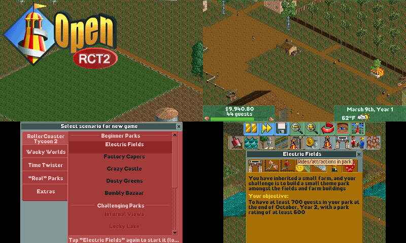
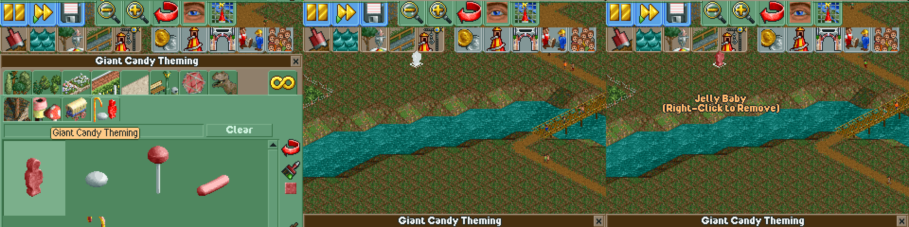
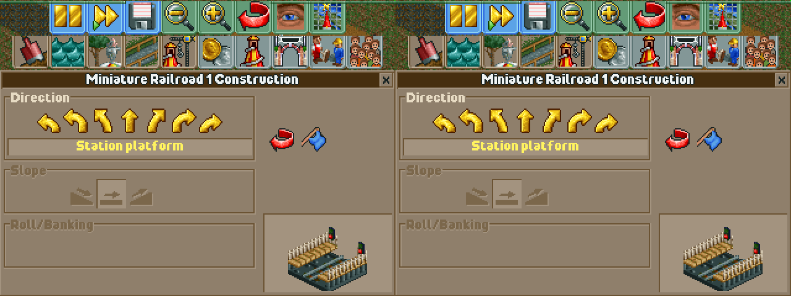

# RTC2-3DS — OpenRCT2 on the New Nintendo 3DS

Play **RollerCoaster Tycoon 2** (and RCT1 scenarios) on your New 3DS, built on the open-source OpenRCT2 engine, with the park on the top screen and all the building on the touch screen.

> This is an unofficial homebrew port of [OpenRCT2](https://github.com/OpenRCT2/OpenRCT2). It contains no game files: you need your own copy of RollerCoaster Tycoon 2 (Steam or GOG). It needs a **New** 3DS / New 2DS with custom firmware (Luma3DS); an original 3DS does not have enough memory.

## Top features

- **Two screens, one park:** the game renders as one 400×480 screen split across both displays. The park and the money/date bars are on the top screen; the map continues onto the touch screen, where you build by tapping it.
- **Touch-first interface:** the two-row toolbar and every window (scenery, paths, rides, finances, scenario select) live on the touch screen and were refitted to 320 px. Tap a window's title bar to collapse it and uncover the map.
- **Console controls:** circle pad scrolls, L/R zoom, A/Y rotate, X opens the map, B closes the top window, START pauses, SELECT opens the options.
- **Quick starts:** after the first run the object index is trusted and decoded objects are cached on the SD card, so the game boots in seconds rather than minutes; a light title park replaces Six Flags Magic Mountain.
- **Uses the hardware:** 178 MB memory mode, 804 MHz with L2 cache, original RCT2 music and sound effects.
- **RCT1 and RCT2 scenarios**, saving and loading, the full OpenRCT2 game logic.

## Screenshots

| Title screen and in game | Placing scenery | Building a ride |
| --- | --- | --- |
|  |  |  |

(Captured in the Azahar emulator; the top half of each frame is the top screen, the bottom half the touch screen.)

## What you need

- A **New 3DS, New 3DS XL or New 2DS XL** with Luma3DS and FBI installed.
- Your **RollerCoaster Tycoon 2** files from the Steam or GOG version (`Data`, `ObjData`, `Scenarios`, `Landscapes`, `Tracks`).
- Optionally RollerCoaster Tycoon 1 files, for the RCT1 scenarios.
- For sound, the DSP firmware dumped once with the DSP1 homebrew (`sdmc:/3ds/dspfirm.cdc`). Without it the game is silent.
- An SD card with about 500 MB free (game data, object cache and saves).

## Install in 4 steps

1. **Download** `openrct2.cia` and `openrct2-3ds-data.zip` from the [releases](../../releases).
2. **Copy the data:** extract the zip so that you get `sdmc:/3ds/openrct2/data/`.
3. **Copy your game:** put your RCT2 folder at `sdmc:/3ds/openrct2/rct2/` (so `sdmc:/3ds/openrct2/rct2/Data/g1.dat` exists). RCT1 goes to `sdmc:/3ds/openrct2/rct1/`.
4. **Install and play:** install the CIA with FBI and start it from the HOME menu. The first start builds the object index (a few minutes); later starts take seconds.

The `.3dsx` can be started from the Homebrew Launcher instead, but it only gets 124 MB of memory and may run out while loading large parks.

## Controls

| Button | Action |
| --- | --- |
| **Stylus** | Tap = click, two quick taps = right click. Keep the stylus still while tapping. |
| **Title bar tap** | Collapse the window to its title bar (tap again to restore). Drag it to move the window. |
| **Circle pad / D-pad** | Scroll the park |
| **L / R** | Zoom out / in |
| **A / Y** (or **ZR / ZL**) | Rotate the view |
| **X** | Map |
| **B** | Close the top-most window |
| **START** | Pause |
| **SELECT** | Options |

All of these are ordinary OpenRCT2 shortcuts and can be changed in the options.

## Supported consoles

| Console | Status |
| --- | --- |
| New 3DS / New 3DS XL / New 2DS XL | Supported (178 MB mode) |
| Original 3DS / 2DS | Not supported: not enough memory |

## Known issues

- Loading a park takes a while: one file read per object on the SD card (about a minute for a typical scenario). The object cache helps from the second load on.
- Fully zoomed out, guests and staff are not drawn, to keep the frame rate up.
- Windows wider than the touch screen are cut off at the right edge; drag them by the title bar or close them with B.
- RCT1 scenarios play, but RCT1's own sprite file is skipped to save memory, so a few RCT1-only graphics use OpenRCT2's substitutes.
- No network play, no plugins/scripting, no TrueType fonts, no OpenMusic (Ogg/FLAC) tracks.
- Input is not processed while a park is loading.

## FAQ / troubleshooting

**It closes right after start or shows "out of memory".** Use the CIA, not the `.3dsx`: the Homebrew Launcher only grants 124 MB.

**"0 scenarios known" / New Game does nothing.** Check `sdmc:/3ds/openrct2/rct2/Scenarios/` holds your `.SC6` files, then delete `sdmc:/3ds/openrct2/OpenRCT2/scenarios.idx` and `objects.idx` to rebuild the index.

**I added objects or scenarios and the game does not see them.** Delete the `.idx` files in `sdmc:/3ds/openrct2/OpenRCT2/`; the index is trusted on later starts.

**No sound.** Dump the DSP firmware with the DSP1 homebrew (creates `sdmc:/3ds/dspfirm.cdc`).

**Something crashed.** `sdmc:/3ds/openrct2/openrct2.log` holds everything the game printed, including memory use at each loading stage; attach it to an issue.

## More documentation

- [Building and SD card layout](distribution/3ds/readme.md)
- [OpenRCT2 documentation](https://docs.openrct2.io/)

## Related projects

- [OpenRCT2-3DS by UhtredOfBamburg](https://github.com/UhtredOfBamburg/OpenRCT2-3DS) — an independent New 3DS port made at the same time; worth a look if you prefer its layout.

## Credits

- [OpenRCT2](https://github.com/OpenRCT2/OpenRCT2) and its contributors — the engine this port is built on (v0.5.6).
- [devkitPro](https://devkitpro.org/) (devkitARM, libctru, citro3d), [SDL2](https://libsdl.org/) and [libzip](https://libzip.org/).
- [Azahar](https://github.com/azahar-emu/azahar) — the emulator used for automated testing.
- RollerCoaster Tycoon 2 is by Chris Sawyer; the game data remains the property of its rights holders.

## How AI was used

The port was developed with Claude as a pair programmer: the changes on the `3ds` branch (platform layer, memory routing, dual-screen rendering, touch interface and the window refits) were written and tested in an emulator with its help, then verified on real hardware by hand.

## Licence

OpenRCT2 and this port are licensed under the [GNU General Public License v3](licence.txt).

## Legal

This project does not include any copyrighted game assets. You must own RollerCoaster Tycoon 2 to use it. Not affiliated with Atari, Frontier Developments, Chris Sawyer or Nintendo.
